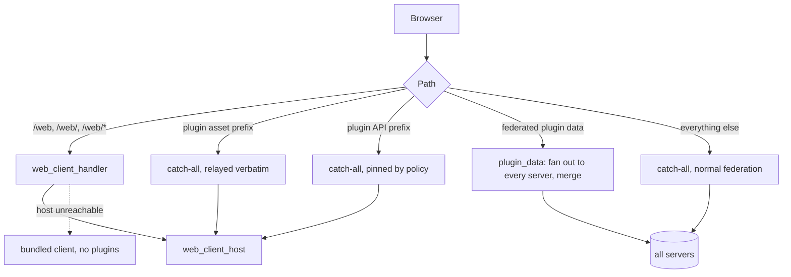

# Plugin Federation

Jellyfin's client-side plugins — Media Bar, Home Screen Sections, Plugin Pages, Custom Tabs,
Jellyfin Enhanced, Jellyfin Tweaks — work by injecting scripts and stylesheets into `jellyfin-web`.
They do that through the [File Transformation][ft] plugin, which rewrites the web client as the
server hands it out.

Jellyswarrm is not a Jellyfin server. It serves its own copy of `jellyfin-web`, embedded at build
time from the `ui` submodule, and nothing injects anything into it. So **by default no client-side
plugin exists at all** through the proxy, no matter what is installed upstream.

Everything in this document follows from that one fact.

[ft]: https://github.com/IAmParadox27/jellyfin-plugin-file-transformation

## The foundation: one pinned origin

`web_client_host` names an origin that serves the browser's client instead of the bundled copy.
Set it to a real Jellyfin server and the client — and every plugin that server injects into it —
comes from there.

The origin is **pinned**, deliberately. Letting `/web/*` resolve a server per request would be
worse than it sounds: unauthenticated asset requests and authenticated API calls resolve through
different predicates, so one page load could take `index.html` from one server and a lazily-loaded
chunk from another. `jellyfin-web` carries its build hash in the *query string*, so the filenames
are identical across builds and nothing 404s — the page simply comes up subtly broken, with a route
or a home row failing to render and nothing logged. Pinning makes that unrepresentable.



Every path that can serve the application must be pinned, `/web/` included. A catch-all does not
match an empty remainder and `/web` does not match `/web/`, so the trailing-slash form needs its own
route — and it is the form clients actually request, both from the `/` redirect and from Jellyfin
Media Player. `web_client_routes()` builds the set in one place so a test can assert on the real
registration rather than a restatement of it.

If the pinned host cannot be reached, the bundled client is served as a fallback with
`Cache-Control: no-store`. Losing the plugin UIs for a minute beats taking down the whole interface,
including the admin page needed to change the setting.

## Policy: what gets pinned, what gets merged

The rule is that **presentation is pinned and media is federated**. A script, a stylesheet or a
plugin's own configuration belongs to the origin that injected it; anything that returns media items
belongs to every server and has to be merged, or that surface silently becomes single-server.

`PluginFederationConfig` holds the policy. All five lists are editable from the Plugins page and
match on path-segment boundaries, so `/MediaBarSomethingElse` is not swept up by `/MediaBar`.

| Field | Shipped default | Behaviour |
| --- | --- | --- |
| `plugin_asset_prefixes` | `/PluginPages`, `/MediaBar`, `/CustomTabs`, `/HomeScreen/home-screen-sections.{js,css}` | Relayed verbatim to the pinned host |
| `plugin_api_prefixes` | `/JellyfinEnhanced`, `/JellyTweaks` | Pinned, but authenticated as the caller |
| `federated_plugin_api_prefixes` | `/JellyfinEnhanced/tag-cache`, `/JellyfinEnhanced/tag-data` | Fanned out to every server and merged |
| `single_source_section_prefixes` | `discover`, `myjellyseerrrequests`, `jellyseerr`, `upcoming` | Answered by one server; merging is meaningless |
| `library_view_sections` | `mymedia` | Resolved from the caller's merged library views |

The two pinning lists are different mechanisms and confusing them is the easy mistake. An **asset**
prefix is relayed verbatim, which sends the *proxy's* own access token — fine for a static file,
wrong for anything that identifies the caller. An **API** prefix is pinned but goes through normal
authorization remapping. Jellyfin Enhanced's endpoints identify the caller, which is why they are in
the API list; pinning `/HomeScreen/Meta` as an asset is what failed.

All five lists are live policy: the catch-all consults them on every request, so adding a prefix
pins a plugin surface immediately — no route to register, no rebuild, no restart. That is what makes
the Plugins page able to enable a plugin the shipped defaults have never heard of.

It was not always so. Asset prefixes were once reached only through a route registered per prefix,
which made the list describe what it could not change: a prefix *added* to it had no route to reach
the handler that read it, so only a removal ever took effect. If you are reading an older branch,
that is the behaviour you have.

### Federated plugin data

A plugin endpoint keyed by item id has to answer for the whole catalogue. `plugin_data` clones the
request once per server, and each leg is processed into virtual id space **before** merging, so no
two legs claim the same key. Objects union, arrays concatenate, and scalars keep the
highest-priority server's value so a payload's own `version` or format marker stays coherent.

Each leg gets `federated_leg_timeout` seconds (default 10) and a leg that fails is dropped with a
warning rather than failing the request — the response is still useful, just missing one server's
contribution.

## What this does not do

Item queries were never the problem. `/Items` and `/Users/{id}/Items` route to
`handlers::federated::get_items_from_all_servers` in the proxy core, so a plugin that asks Jellyfin
for media already receives it merged from every server. Pinning applies only to the plugin's own
scripts, styles and configuration.

Plugin **compatibility** is upstream's business. The IAmParadox27 repository pins `targetAbi` to the
exact Jellyfin minor version, so every minor upgrade empties the plugin catalogue until new builds
are published, and upgrading Jellyfin never upgrades an installed plugin. Install File
Transformation first; the others fail with assembly-load errors without it.

## Diagnosing it

The failure mode worth knowing is that **a missing plugin UI looks like nothing at all**. No error,
no log line, a page that renders. These checks separate the layers:

```bash
# 1. Is the proxy relaying the pinned client, or serving its own?
#    Identical hashes and a plugin script count above zero mean the relay is working.
curl -s http://PROXY/web/ | md5sum
curl -s http://SERVER/web/index.html | md5sum
curl -s http://PROXY/web/ | grep -c 'MediaBar\|HomeScreen\|PluginPages'

# 2. Are the plugin's own assets reaching the browser?
#    The first six are relayed verbatim and must match the server exactly.
for P in /MediaBar/slideshowpure.js /MediaBar/WebConfig /HomeScreen/home-screen-sections.js \
         /PluginPages/inject.js /JellyfinEnhanced/script /JellyTweaks/script; do
  curl -s -o /dev/null -w "$P %{http_code}\n" "http://PROXY$P"
done

# 3. What is the proxy deciding? (needs RUST_LOG=jellyswarrm_proxy=debug)
docker logs --since 3m jellyswarrm 2>&1 | grep -iE \
  "Relaying|Pinning plugin asset|Federating plugin data|Failed to preprocess|abandoned|timed out"
```

`Pinning plugin asset ... to the web client host` confirms the policy matched and the request was
relayed; its absence for a path you expected means that prefix is not in `plugin_asset_prefixes`,
and the request went to ordinary federation instead. `Federating plugin data ... across N servers`
is the fan-out working; `abandoned` or `timed out` means a leg exceeded `federated_leg_timeout`.

Two traps that cost real time:

- **Compare the path the client actually requests.** `/web/index.html` and `/web/` were served by
  different code paths, so comparing `index.html` through the proxy against the server showed a
  byte-identical response while every browser ran a different build.
- **`curl` does not reproduce a browser.** It sends no `Accept-Encoding` and has no cache, so it
  cannot see an encoding mismatch or a stale heuristically-cached asset.

## Related

- [`docs/config.md`](config.md) — all configuration fields
- [`docs/request-response-processing.md`](request-response-processing.md) — how ids are rewritten
- [`docs/porting-to-upstream.md`](porting-to-upstream.md) — re-applying this work to a new release
